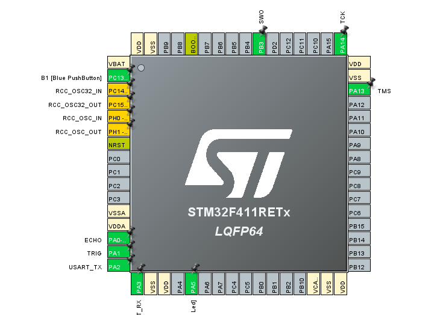
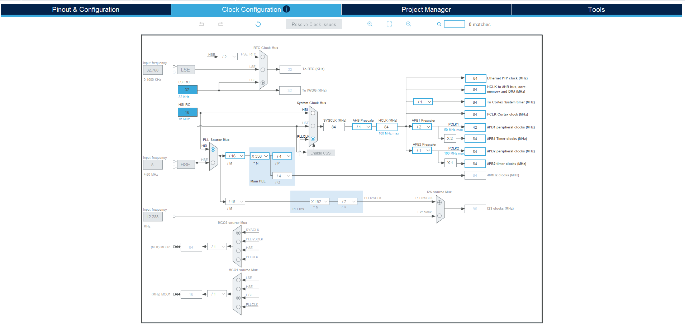
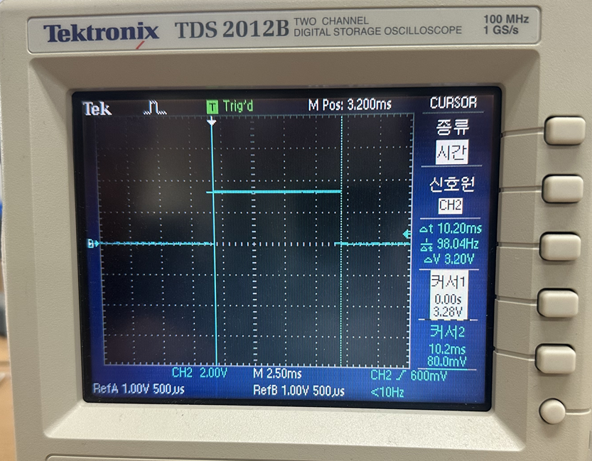
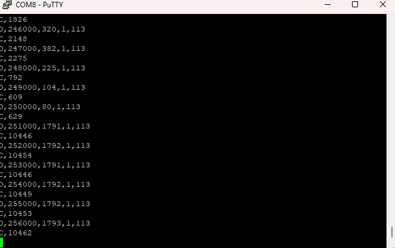
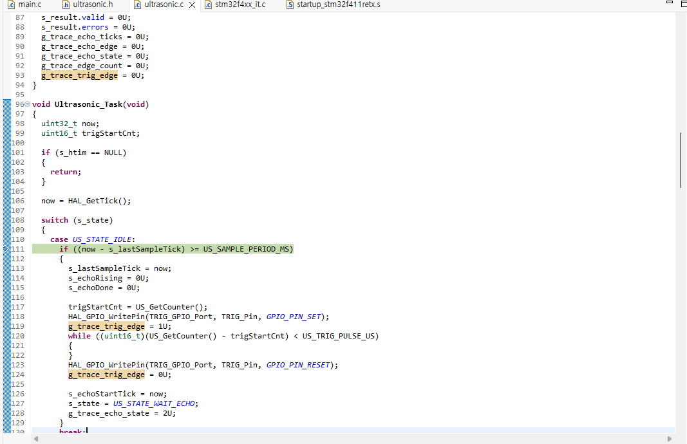
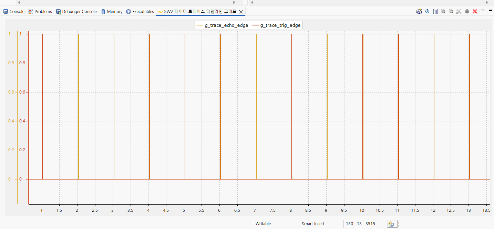
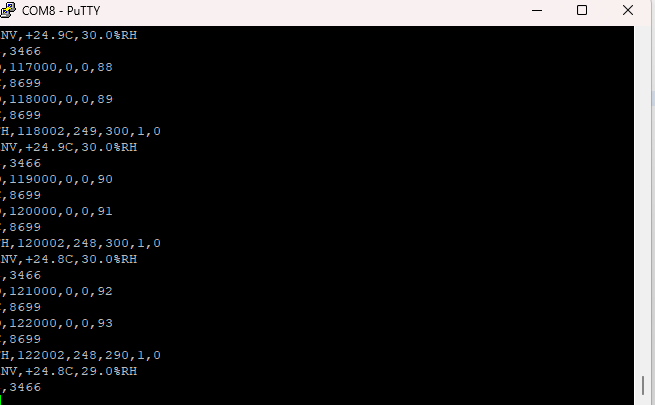
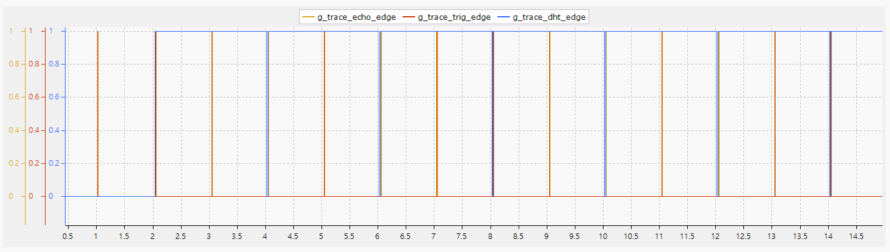

# F411_LAB

NUCLEO-F411RE(STM32F411RET6) 실습 정리  
초음파 거리 측정 → SWV/트레이스 관찰 → DHT 온습도 센서 확장

- 실습일: 2026-11-19
- 개발 환경: STM32CubeMX 6.18.1 / STM32CubeIDE, STM32Cube FW_F4 V1.28.3
- 장비: Tektronix TDS2012B 오실로스코프, PuTTY(COM8)

---

## 0. 실습 흐름 (체크포인트)

| 단계 | 목표 | 확인 방법 | 사진 |
|---|---|---|---|
| ① | 핀·클럭·타이머 설정 | CubeMX 핀맵, 클럭 트리 | 1, 2 |
| ② | 초음파 Echo 펄스 폭 확인 | 오실로스코프 커서 측정 | 3 |
| ③ | 거리 값을 PC로 출력 | PuTTY 출력 | 4 |
| ④ | Trig 상태 변수 추가 | 소스 코드 | 5 |
| ⑤ | SWV로 Trig/Echo 엣지 관찰 | SWV 타임라인 그래프 | 6 |
| ⑥ | DHT 온습도 센서 추가 | PuTTY 출력 | 7 |
| ⑦ | DHT 엣지까지 SWV로 관찰 | SWV 타임라인 그래프 | 8 |

---

## 1. CubeMX 설정

### 1-1. 핀 설정



| 핀 | 라벨 | 모드 | 용도 |
|---|---|---|---|
| PA0 | ECHO | EXTI0 (Rising/Falling) | 초음파 반사 신호 입력 |
| PA1 | TRIG | GPIO Output | 초음파 발사 펄스 출력 |
| PA2 / PA3 | USART_TX / RX | USART2 Asynchronous | PuTTY 출력 |
| PA5 | LD2 | GPIO Output | 보드 LED |
| PC13 | B1 | EXTI13 (Falling) | 보드 푸시 버튼 |
| PA13 / PA14 / PB3 | TMS / TCK / SWO | Trace Asynchronous SW | 디버깅, SWV 출력 |

### 1-2. 클럭 설정



```
HSI 16 MHz ÷ M(16) = 1 MHz  ← PLL 입력
1 MHz × N(336)     = 336 MHz ← VCO
336 MHz ÷ P(4)     = 84 MHz  ← SYSCLK = HCLK
```

| 항목 | 값 | 비고 |
|---|---|---|
| SYSCLK / HCLK | 84 MHz | AHB ÷1 |
| APB1 (PCLK1) | 42 MHz | ÷2 (타이머 클럭은 ×2 = 84 MHz) |
| APB2 (PCLK2) | 84 MHz | TIM1 입력 클럭 |
| UART | 115200 bps, 8N1 | 흐름 제어 없음 |

### 1-3. 타이머 설정 (TIM1)

```
타이머 틱 = 84 MHz ÷ (Prescaler 83 + 1) = 1 MHz  →  1 tick = 1 µs
```

- Counter: Up, Period 65535 (16비트 free-running)
- Echo 펄스 폭을 µs 단위로 직접 측정하기 위해 1 MHz로 설정
- 최대 측정 가능 시간 약 65.5 ms (코드의 Echo 타임아웃 35 ms보다 큼)

---

## 2. 초음파 측정 원리와 오실로스코프 확인



### 동작 순서

1. MCU가 TRIG(PA1)에 10 µs High 펄스 출력
2. 센서가 초음파 발사 후, 반사파 수신 시까지 ECHO(PA0)를 High로 유지
3. ECHO 상승 엣지에서 타이머 값 저장, 하강 엣지에서 차이 계산
4. **Echo High 시간 = 왕복 비행시간**

### 오실로스코프 측정 결과 (CH2, 2 V/div, 2.5 ms/div)

| 항목 | 값 |
|---|---|
| 커서 간격 Δt | 10.20 ms (Echo High 폭) |
| 전압 Δ V | 3.20 V (Echo 출력 로직 레벨) |
| 환산 거리 | 10200 µs × 0.343 ÷ 2 ≈ 1749 mm (약 1.75 m) |

---

## 3. PuTTY 출력 결과



출력 형식 (`main.c`의 `Sensor_Task`)

| 줄 | 형식 | 의미 |
|---|---|---|
| `D,` | `D,시간[ms],거리[mm],valid,errors` | 1초마다 중앙값 필터링된 거리 |
| `C,` | `C,echo 틱 수` | 마지막 Echo 폭 (1틱 = 1 µs) |

교차 검증 (사진 4 기준)

```
C,10446 → 10446 × 3430 ÷ 20000 = 1791.4  →  D 줄의 1791 mm 와 일치
```

- 오실로스코프로 본 Echo 폭(약 10.2 ms)과 PuTTY 값(약 10.45 ms)이 같은 수준
- 신호(오실로스코프) → 계산 결과(PuTTY)가 서로 맞는 것을 확인

### 소프트웨어 처리 요약

| 항목 | 값 |
|---|---|
| 측정 주기 | 1000 ms (`US_SAMPLE_PERIOD_MS`) |
| Echo 타임아웃 | 35 ms |
| 유효 Echo 폭 | 100 ~ 30000 µs |
| 유효 거리 | 20 ~ 4000 mm |
| 필터 | 5샘플 중앙값 |

---

## 4. Trig 추적 변수 추가



- 최초: Echo 쪽 추적 변수만 있던 상태
- 추가: Trig 펄스 시점을 SWV에서 볼 수 있도록 `g_trace_trig_edge` 선언 및 대입 추가

| 위치 | 코드 | 의미 |
|---|---|---|
| 초기화 | `g_trace_trig_edge = 0U;` | 초기값 0 |
| TRIG High 직후 | `g_trace_trig_edge = 1U;` | 발사 시작 표시 |
| TRIG Low 직후 | `g_trace_trig_edge = 0U;` | 발사 종료 표시 |

- 기존 추적 변수: `g_trace_echo_ticks`, `g_trace_echo_edge`, `g_trace_echo_state`, `g_trace_edge_count`
- 전역 `volatile` 변수로 두어야 디버거가 값 변화를 읽을 수 있음

---

## 5. SWV / 트레이스 관찰

### 5-1. SWV 설정

> 설정 화면 사진(SWV Configuration)은 추가 예정 → `img/` 폴더에 넣은 뒤 이 자리에 삽입

| 항목 | 값 | 비고 |
|---|---|---|
| 디버그 핀 | SWDIO(PA13), SWCLK(PA14), SWO(PB3) | CubeMX에서 Trace Asynchronous SW 설정 |
| Core Clock | 84 MHz | CubeMX 클럭 설정과 같아야 함 |
| 관찰 변수 | `g_trace_echo_edge`, `g_trace_trig_edge` | Data Trace Timeline Graph |

### 5-2. SWV 데이터 트레이스 타임라인 그래프



- 빨간색: `g_trace_trig_edge`, 주황색: `g_trace_echo_edge`
- 약 1초 간격으로 Trig 펄스 후 Echo 엣지가 이어지는 것 확인
- 코드의 측정 주기(1000 ms)와 그래프 주기가 일치

---

## 6. DHT 온습도 센서 추가



- DHT 헤더 파일, 소스 파일을 프로젝트에 추가해 `main.c`와 연동
- PuTTY 출력에 온습도 줄 추가: 예) `+24.9C, 30.0%RH`
- DHT 데이터 줄은 약 2초 간격 (시간 값 118002 → 120002 → 122002 ms)
- 데이터 줄 형식(추정): `시간[ms], 온도×10, 습도×10, valid, errors` → `249, 300` = 24.9 °C, 30.0 %RH

음속은 온도에 따라 변하므로 DHT 온도로 보정 가능

```
음속[m/s] ≈ 331.3 + 0.606 × 온도[°C]       (예: 24.9 °C → 약 346.4 m/s)
```

- 코드에 `Ultrasonic_SetSoundSpeedX10()` 함수 존재 (허용 범위 250 ~ 400 m/s)
- 거리 결과에 기준값(343 m/s) 거리와 보정 거리가 따로 있음 (`distance_ref_mm`, `distance_mm`)

---

## 7. DHT SWV 관찰

> 설정 화면 사진은 추가 예정 → `img/` 폴더에 넣은 뒤 이 자리에 삽입



- 관찰 변수 3개: `g_trace_echo_edge`, `g_trace_trig_edge`, `g_trace_dht_edge`
- Trig/Echo는 약 1초 주기, DHT는 약 2초 주기로 나타남
- 센서별 동작 시점을 한 그래프에서 비교 가능

---

## 8. 실습 정리

| 확인한 것 | 방법 |
|---|---|
| Echo 폭 → 거리 환산 | 오실로스코프 + PuTTY 교차 확인 |
| 타이머 1 µs 틱 설정 | 84 MHz ÷ 84 = 1 MHz |
| Trig/Echo 타이밍 | SWV 타임라인 그래프 |
| 복수 센서 동작 | DHT 추가 후 PuTTY / SWV 확인 |

## 9. 메모 / 확인 필요

| 항목 | 내용 |
|---|---|
| 사진 7 초음파 값 | `D` 줄이 `distance=0, valid=0`이고 errors가 매초 1씩 증가 → 원인 확인 필요 (센서 앞 물체, DHT 추가 영향 등) |
| 메시지 문구 | `main.c`의 시작 문구는 "5 Hz sample"인데 코드의 측정 주기는 1000 ms (1 Hz) |
| 소스 반영 | 레포의 `ultrasonic.c`에는 아직 `g_trace_trig_edge`, DHT 파일 없음 → 커밋 필요 |
